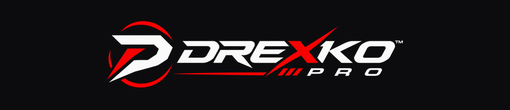
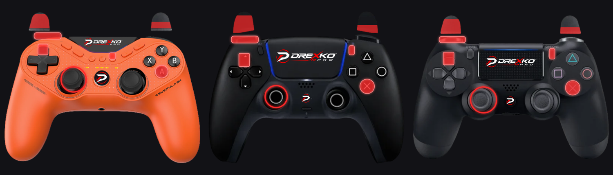
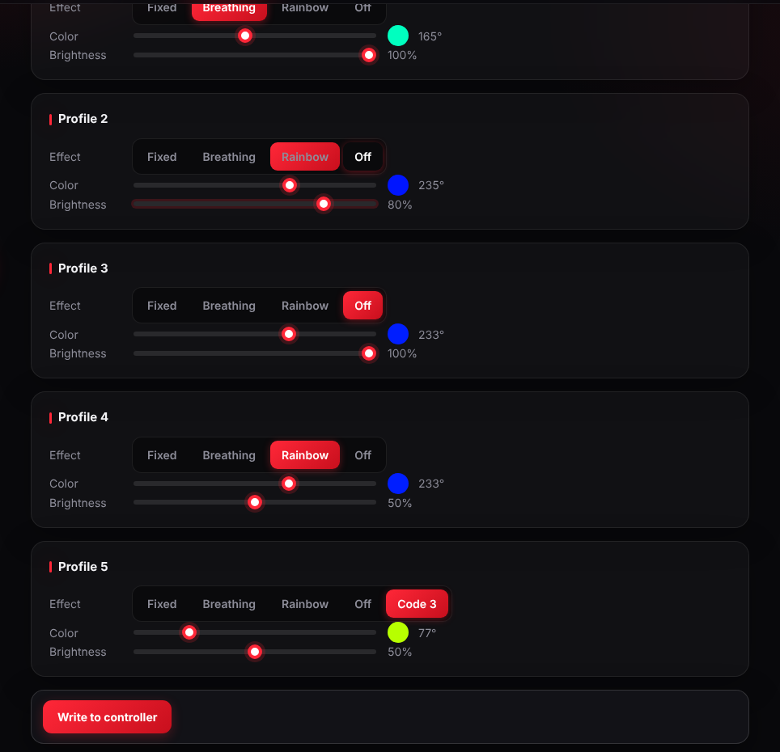

# DREXKO PRO — controller configuration app for Windows

**DREXKO PRO** is a free Windows app to configure **DREXKO** controllers and the **GameSir Tarantula 8K PC** controller: 8000 Hz polling, stick deadzones and response curves, triggers, button remapping (also to keyboard and mouse), RGB lighting, 5 onboard profiles, automatic profile switching per game, and a live **OBS overlay** for streaming.

**[⬇ Download the latest installer](downloads/)** — open the `downloads` folder and get the newest `DREXKO_PRO_Setup_x.x.x.exe` (the latest version is listed in [`latest.json`](latest.json)). Install it once; after that DREXKO PRO updates itself from **Settings → Updates**.

*[Español abajo](#español)*

---

## Features

- **Polling rate** up to **8000 Hz** (250 / 1000 / 4000 / 8000 Hz)
- **Sticks** – deadzone, anti-deadzone, Circle / Raw trajectory, resolution, response curves with a visual curve editor
- **Triggers** – deadzones and curve
- **Button remapping** – any button to another button, a keyboard key or a mouse click, including the back buttons (L4, R4, C1–C4, T1–T3)
- **Lighting** – effect (fixed, breathing, rainbow, off), color and brightness for each profile
- **5 onboard profiles** stored in the controller, plus an unlimited profile library saved on your PC
- **Auto-switch by game** – the controller switches profile when your game window is in front
- **OBS overlay** – live buttons, sticks and triggers on stream with PS4, PS5 or Tarantula 8K controller art and the DREXKO logo. Buttons mapped to keyboard keys also light up
- **Monitor, calibration and tests** – live input view, real polling measurement, button timing
- **Backups** – full backup of the controller memory before you change anything
- Runs in the **tray**, can **start with Windows**, and **updates itself**
- No turbo, no aim macros, no jitter: DREXKO PRO is built for fair play

## Supported controllers

| Controller | Status |
|---|---|
| GameSir Tarantula 8K PC (USB cable) | Supported |
| DREXKO 8K | Firmware in development |

## OBS overlay

In DREXKO PRO open **Settings → OBS overlay**, choose the controller and the glow color, copy the link, and in OBS add **Sources → + → Browser** with width **800** and height **640**. DREXKO PRO must be running (the tray is enough).

## Lighting

## Install

1. Download the newest `DREXKO_PRO_Setup_x.x.x.exe` from [`downloads`](downloads/).
2. Run it. Windows SmartScreen may warn because the installer is not code-signed yet: click **More info → Run anyway**.
3. Close **GameSir Connect** before connecting the controller in DREXKO PRO (only one app can talk to the controller at a time).
4. Connect the controller with a USB cable and click **Connect**.

**Requirements:** Windows 10 or 11 (64-bit), Microsoft Edge or Google Chrome installed, USB cable.

---

## Español

**DREXKO PRO** es una app gratis para Windows que configura los controles **DREXKO** y el **GameSir Tarantula 8K PC**: polling de 8000 Hz, zonas muertas y curvas de los sticks, gatillos, remapeo de botones (también a teclado y ratón), luces RGB, 5 perfiles en el control, cambio automático de perfil por juego y **overlay para OBS** en vivo.

**[⬇ Descargar el instalador](downloads/)** — abre la carpeta `downloads` y baja el `DREXKO_PRO_Setup_x.x.x.exe` más nuevo (la versión actual está en [`latest.json`](latest.json)). Se instala una sola vez; después DREXKO PRO se actualiza solo desde **Settings → Updates**.

**Funciones**
- **Polling** hasta **8000 Hz**
- **Sticks**: zona muerta, anti zona muerta, trayectoria Circle / Raw, resolución y curvas de respuesta con editor visual
- **Gatillos**: zonas muertas y curva
- **Remapeo de botones** a otro botón, a una tecla o a un clic del ratón, incluidos los botones traseros (L4, R4, C1–C4, T1–T3)
- **Luces**: efecto (fijo, respiración, arcoíris, apagado), color y brillo por perfil
- **5 perfiles** guardados en el control y biblioteca ilimitada de perfiles en tu PC
- **Cambio automático de perfil por juego**
- **Overlay para OBS** con el PS4, el PS5 o el Tarantula 8K y el logo DREXKO; los botones programados como tecla también se iluminan
- **Monitor, calibración y pruebas**, y **respaldo** completo de la memoria del control
- Corre en la **bandeja**, puede **arrancar con Windows** y **se actualiza solo**
- Sin turbo, sin macros de aim, sin jitter

**Instalación**
1. Baja el `DREXKO_PRO_Setup_x.x.x.exe` más nuevo de [`downloads`](downloads/).
2. Ábrelo. Si Windows SmartScreen avisa (el instalador todavía no está firmado), toca **Más información → Ejecutar de todas formas**.
3. Cierra **GameSir Connect** antes de conectar el control en DREXKO PRO.
4. Conecta el control por cable USB y toca **Connect**.

**Requisitos:** Windows 10 u 11 (64 bits), Microsoft Edge o Google Chrome, cable USB.

---

DREXKO PRO is an independent project and is not affiliated with, endorsed by or sponsored by GameSir, Sony or Microsoft. GameSir, Tarantula, PlayStation, DualShock and DualSense are trademarks of their respective owners and are used only to describe compatibility.
